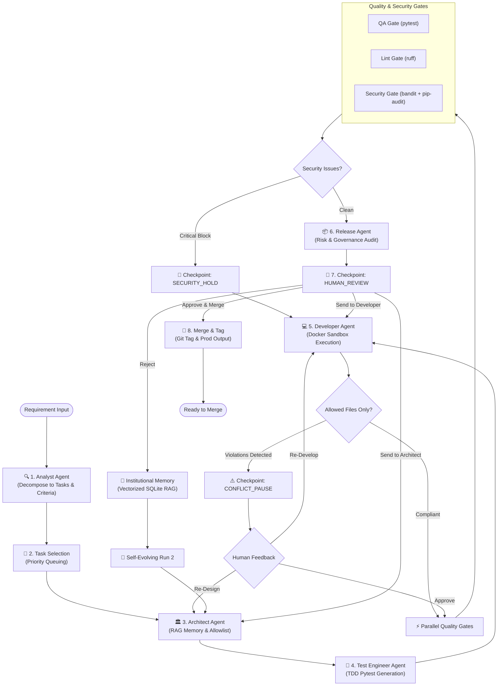

# 🌲 Pine: Autonomous Engineering Organisation

[](https://www.python.org/downloads/)
[](https://www.docker.com/)
[](https://fastapi.tiangolo.com/)
[](https://langchain-ai.github.io/langgraph/)
[](https://ai.google.dev/)
[](tests/)

An enterprise-grade, multi-agent AI system that simulates an entire autonomous software engineering department. Powered by **LangGraph**, **Google Gemini**, and a hardened **Docker Sandbox**, the system transforms natural language business requirements into tested, verified, and audited production-ready pull requests.

---

## 🌟 Key Highlights

* **Test-Driven Development (TDD) by Default**: Tests are generated and validated *before* any implementation code is authored.
* **Hermetic Docker Sandbox**: Implementation and quality gates execute within a resource-capped (`pids_limit=64`, `mem_limit=512m`, non-root `agent`) container isolated from host networks.
* **Architectural Allowlist & Conflict Pausing**: The Architect agent sets strict file boundaries. Any unauthorized file modifications outside the allowlist are rolled back and paused (`CONFLICT_PAUSE`).
* **DevSecOps Quality Gates**: Parallel execution of unit testing (`pytest`), linting (`ruff`), Static Application Security Testing (`bandit`), and dependency audit (`pip-audit`).
* **Self-Evolution via RAG Memory**: Rejection critiques from human review checkpoints are vectorized with Gemini embeddings and recorded into SQLite (`institutional_memory`). Subsequent runs retrieve past critiques to avoid repeating mistakes.
* **Interactive Web Dashboard**: Real-time Server-Sent Events (SSE) telemetry, dynamic state pipeline visualization, and human-in-the-loop review checkpoints.

---

## 🏗️ System Architecture

The workflow is governed by a state machine implemented in **LangGraph**:



---

## 👥 The Agent Roster

| Agent Name | Role | Responsibilities | Tools / Environment |
|---|---|---|---|
| **Analyst Agent** | Lead Systems Analyst | Analyzes plain-English requirements, examines repository structure, extracts 3–6 testable acceptance criteria, and prioritizes atomic tasks. | Gemini Flash, Sandbox inspection |
| **Architect Agent** | Principal Software Architect | Queries institutional memory via RAG for past rejections, defines technical components, and enforces a strict minimal file allowlist. | Gemini Flash/Pro, Gemini Embeddings, SQLite RAG |
| **Test Engineer Agent** | Lead Automation Engineer | Adheres to TDD principles: writes comprehensive `pytest` suites before implementation begins, asserting functional and boundary conditions. | Gemini Flash, pytest, Sandbox execution |
| **Developer Agent** | Senior Python Engineer | Implements code in the isolated workspace, enforces backward compatibility, and checks against the Architect's allowlist. | Gemini Flash, Docker sandbox, Git |
| **QA Agent** | Test Verification Officer | Executes test suites in the sandbox, parsing JSON test telemetry, tracking assertions, and reporting failures. | `pytest`, `pytest-json-report` |
| **Lint Agent** | Code Quality Officer | Enforces PEP 8 compliance, formatting, and import organization. | `ruff check` |
| **Security Agent** | DevSecOps Engineer | Conducts SAST code analysis and checks third-party dependencies for known CVEs. | `bandit`, `pip-audit` |
| **Release Agent** | Staff Governance Engineer | Synthesizes test reports and diffs, conducts automated risk assessments (precision, floating point, unhandled exceptions), and drafts release notes. | Gemini Flash, Evidence synthesis |

---

## 🔄 Self-Evolution Loop: How It Works

1. **Run 1 Execution**:
   * A requirement is submitted (e.g., *"Add discount coupon feature to cart. Support SAVE10 and SAVE20."*).
   * The pipeline executes, and code is presented at the `HUMAN_REVIEW` checkpoint.
2. **Human Governance & Critique**:
   * The reviewer inspects the diff and inputs feedback:
     > *"Define coupons in cart/models.py, do not hardcode in services.py. Ensure invalid coupons raise ValueError."*
   * The reviewer clicks **Reject**.
3. **Vectorized Institutional Memory**:
   * The system generates a high-dimensional vector embedding of the requirement using Gemini Embedding.
   * The requirement, design pattern, code diff, rejection verdict, and human critique are stored in SQLite (`institutional_memory`).
4. **Run 2 (Self-Evolution)**:
   * When Run 2 starts, the Architect Agent retrieves the historical critique via cosine similarity (`threshold = 0.72`).
   * The Architect dynamically incorporates the past lessons into the architectural constraints.
   * The resulting implementation strictly adheres to the requested pattern without further manual intervention.

---

## 📂 Repository Layout

```text
├── api/
│   ├── server.py              # FastAPI application & SSE event stream
│   ├── static/                # Static assets
│   └── templates/
│       └── dashboard.html     # Interactive state diagram dashboard
├── docker-compose.yml         # Container sandbox specification
├── Dockerfile.orchestrator    # Orchestrator image
├── Dockerfile.sandbox         # Hardened non-root sandbox container
├── docs/                      # Architectural specifications
├── evals/                     # Agent evaluation benchmarks
├── orchestrator/
│   ├── agents/                # Agent definitions (Analyst, Architect, Dev, etc.)
│   ├── memory/                # RAG storage, vector embeddings & SQLite store
│   ├── tools/                 # Sandbox bridge, git automation, docker client
│   ├── graph.py               # LangGraph state machine definition
│   └── state.py               # TypedDict definitions for graph state
├── sample-repo/               # Target microservice (Cart & Payment service)
│   ├── cart/
│   │   ├── models.py
│   │   └── services.py
│   └── tests/
│       └── test_cart.py
├── tests/                     # 29 automated end-to-end integration tests
└── pyproject.toml             # Project dependencies and configuration
```

---

## 🚀 Getting Started

### Prerequisites

* **Python**: 3.12 or higher
* **Docker**: Docker Desktop (running on host)
* **Google Gemini API Key**: [Get a Gemini API Key](https://aistudio.google.com/)

### 1. Clone the Repository

```bash
git clone https://github.com/Aryaman-c/pinelabs-case3-autonomous-engineering.git
cd pinelabs-case3-autonomous-engineering
```

### 2. Configure Environment

Create a `.env` file based on `.env.example`:

```bash
cp .env.example .env
```

Edit `.env` and supply your Gemini API key:

```env
GEMINI_API_KEY=your_actual_gemini_api_key_here
GEMINI_MODEL_FAST=gemini-2.0-flash-exp
GEMINI_MODEL_SMART=gemini-2.0-flash-exp
WORKFLOW_DB_PATH=data/workflows.db
SANDBOX_CONTAINER_NAME=autonomous-eng-org-sandbox
MAX_DEVELOPER_RETRIES=3
MAX_AGENT_JSON_RETRIES=2
```

### 3. Start the Docker Sandbox

Build and run the unprivileged sandbox container in the background:

```bash
docker compose up -d sandbox
```

Verify that the container is running:

```bash
docker ps --filter "name=autonomous-eng-org-sandbox"
```

### 4. Install Dependencies & Launch Application

Install Python requirements:

```bash
pip install -e .
```

Start the FastAPI application:

```bash
python -m uvicorn api.server:app --host 127.0.0.1 --port 8080
```

Open your browser to: **[http://127.0.0.1:8080](http://127.0.0.1:8080)**

---

## 🧪 Running Automated Tests

Run the complete test suite (29 tests covering all 15 verification stages):

```bash
pytest -v
```

All 29 tests verify:
* Sandbox container execution, PID limits, and network isolation
* Agent prompt schema validation and structured JSON parsing
* LangGraph state machine routing and conditional checkpoints
* TDD test generation and failure-before-code verification
* Parallel execution of QA, lint, and security quality gates
* Boundary violation rollbacks and `CONFLICT_PAUSE` triggers
* SQLite RAG memory recording, vector embedding similarity, and self-evolution across runs

---

## 🛡️ Security & Sandbox Hardening

The sandbox uses defense-in-depth container security:
* **Network Mode**: `none` (zero external internet egress during execution)
* **Process Limit**: `pids_limit: 64` (mitigates fork-bomb attacks)
* **Memory Limit**: `mem_limit: 512m` (prevents memory exhaustion)
* **Linux Capabilities**: `cap_drop: ALL` (drops all Linux root capabilities)
* **Unprivileged User**: `user: "1000:1000"` (runs strictly as user `agent`)
* **Auto-Recovery**: Automatic container health detection with instant restart recovery on transient WSL2 / Docker runc errors.

---

## 📄 License

This project is licensed under the MIT License. See [LICENSE](LICENSE) for details.
